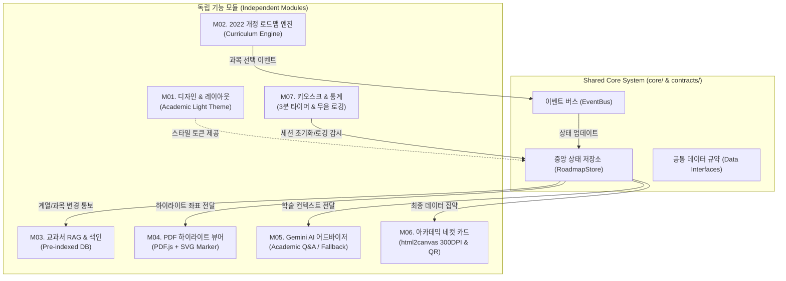

# 「나의 영어과목 3개년 로드맵 빌더」 프로젝트 마스터 아키텍처 및 최종 개발 계획서
**대상:** 의령여자고등학교 선택과목 박람회 영어과 부스  
**컨셉:** Academic Light (영미권 저널/옥스퍼드 스타일의 정제된 미학)  
**설계 원칙:** 모듈 독립성(Decoupling), 단일 상태 규약(State Contract), 결함 격리(Fault Tolerance)

---

## 1. 아키텍처 핵심 원칙: "독립 모듈형 점진적 개발 체계"

각 모듈을 개별적으로 개발·수정·고도화하더라도 전체 시스템이 충돌 없이 유지될 수 있도록 **단일 상태 버스(Event & State Store)** 기반의 모듈화 설계를 적용합니다.



### 모듈 간 독립성 보장 전략
1. **No Direct Inter-Module Dependency (직접 참조 금지):**
   - 모듈 A가 모듈 B의 내부 DOM이나 전용 함수를 직접 호출하지 않습니다.
   - 모든 데이터 교환은 **`RoadmapStore`**와 **`EventBus`**를 통해서만 발생합니다.
2. **모듈별 Standalone Mocking (독립 테스트 가능):**
   - 각 모듈 디렉토리 내에 독립 실행 및 검증이 가능한 구조를 두어, 다른 모듈의 완성 여부와 상관없이 해당 모듈 단독으로 브라우저에서 실행 및 검증이 가능합니다.
3. **Graceful Fallback (장애 격리):**
   - 만약 Gemini API(M05) 장애 또는 인터넷 불안정 시에도, M03의 사전 구축된 '세특 템플릿(Fallback se-teuk)'이 즉시 대체 작동하여 네컷 카드(M06) 출력이 중단되지 않습니다.

---

## 2. 프로젝트 디렉토리 구조 (모듈화 파일 트리)

```text
c:\Antigravity\subject-selection-booth-phimography2/
├── index.html                    # 메인 통합 진입점 (단일 페이지 웹앱)
├── package.json                  # 빌드 도구 및 종속성 (Vite 권장)
├── vite.config.js
│
├── core/                         # [중앙 코어: 불변의 계약]
│   ├── store.js                  # 중앙 상태 관리자 (RoadmapStore)
│   ├── event-bus.js              # 모듈 간 비동기 이벤트 발행/구독
│   └── types.js                  # 데이터 규약 및 유효성 검사기
│
├── modules/                      # [7개 독립 모듈]
│   ├── m01-design/               # M01. 디자인 시스템 & Academic 테마
│   │   ├── tokens.css            # Oxford Navy, Antique Amber, Typography
│   │   ├── components.css        # 버튼, 카드, 뱃지, 모달 스타일
│   │   └── shell.js              # 기본 반응형 레이아웃 셸
│   │
│   ├── m02-curriculum/           # M02. 2022 개정 교육과정 로드맵 엔진
│   │   ├── curriculum-data.js    # 6대 계열 및 과목 정보/수능 플래그
│   │   └── curriculum-engine.js  # 3개년 과목 선택 규칙 및 검증기
│   │
│   ├── m03-textbook-rag/         # M03. 교과서 데이터 매핑 & RAG 인덱스
│   │   ├── indexed-db.json       # 사전 색인된 단원, 본문 스니펫, 하이라이트 좌표
│   │   └── rag-matcher.js        # 진로 계열 ↔ 교과 단원 초고속 매칭 (1ms)
│   │
│   ├── m04-pdf-viewer/           # M04. 교과서 원본 PDF 하이라이팅 뷰어
│   │   ├── pdf-canvas-renderer.js# PDF.js 기반 캔버스 렌더러
│   │   ├── svg-highlighter.js    # 텍스처 형광펜 오버레이 & 툴팁 엔진
│   │   └── viewer-modal.js       # 원본 보기 팝업 뷰어 UI
│   │
│   ├── m05-academic-ai/          # M05. Gemini API 기반 아카데믹 어드바이저
│   │   ├── gemini-client.js      # Gemini 1.5 Flash 통신 어댑터
│   │   ├── prompt-templates.js   # 3단 구성 엄격 프롬프트 엔지니어링
│   │   └── offline-fallback.js   # 네트워크 단절 대비 고품질 세특 프리셋
│   │
│   ├── m06-photocard/            # M06. 아카데믹 네컷 카드 & QR 발송
│   │   ├── card-template.js      # 4x6 인치 규격 4프레임 아카데믹 인포그래픽 DOM
│   │   ├── card-renderer.js      # html2canvas 300DPI 렌더러 & 이미지 저장
│   │   └── qr-generator.js       # 로드맵 웹 재확인용 QR 생성기
│   │
│   └── m07-dashboard-kiosk/      # M07. 현장 키오스크 & 관리자 대시보드
│       ├── idle-timer.js         # 3분 미입력 시 자동 세션 리셋 엔진
│       ├── telemetry-logger.js   # 익명 로깅 클라이언트 (Supabase/Firebase/Local)
│       └── admin-view.js         # 교사용 1학년 진로/과목 수요 차트 화면
│
└── public/                       # 정적 에셋 (교과서 PDF 조각, 엠블럼, 폰트)
    ├── assets/
    │   ├── school-emblem.svg     # 의령여자고등학교 심볼
    │   └── fonts/
    └── textbook-slices/          # 최적화된 교과서 핵심 단원 PDF/WebP 조각
```

---

## 3. 중앙 상태 규약 (The Single Source of Truth: `RoadmapStore`)

어느 모듈을 수정하든 아래의 데이터 인터페이스 스키마를 준수하면 전체 시스템이 깨지지 않습니다.

```javascript
// core/store.js - 중앙 상태 데이터 모델 규격
export const InitialRoadmapState = {
  // 1. 학생 프로필 (M07에서 3분 타이머로 리셋, DB 비저장)
  profile: {
    grade: 1,
    classNum: null,   // 예: 2반
    studentNum: null, // 예: 14번
    name: "",         // 예: 김의령 (화면/카드 출력 전용)
    targetCareer: "", // 예: 글로벌 AI 윤리 전문가
    careerCategory: ""// 6대 계열 중 택 1 (예: "공학·IT·인공지능 계열")
  },

  // 2. 3개년 교육과정 과목 선택 상태 (M02)
  curriculum: {
    year1: ["공통영어1", "공통영어2"], // 필수 고정
    year2: ["영어Ⅰ", "영어 독해와 작문"], // 추천/선택
    year3Career: [], // 진로선택 (예: 영미 문학 읽기)
    year3Fusion: []  // 융합선택 (예: 실생활 영어 회화)
  },

  // 3. 매칭된 교과서 데이터 (M03 & M04)
  matchedTextbook: {
    chunkId: null,
    textbookTitle: "",
    unitTitle: "",
    pageNumber: 0,
    topicEn: "",
    snippetText: "",
    highlightCoords: [],
    pdfSourceUrl: ""
  },

  // 4. AI 학술 피드백 & 세특 (M05)
  academicAdvice: {
    academicLink: "",     // 1. 학문적 연계성 (2문장)
    seTeukGuideline: "",  // 2. 세특 작성 가이드 (1문장)
    academicAdvantage: "",// 3. 수능/학업 역량 이점 (1문장)
    isAiGenerated: false  // 온라인 AI or 오프라인 Fallback 여부
  },

  // 5. 네컷 카드 출력 상태 (M06)
  cardExport: {
    generatedImageUrl: null,
    qrUrl: null,
    exportedAt: null
  }
};
```

---

## 4. 모듈별 상세 명세 & 독립 개발 가이드

사용자께서 **"지금부터 M0O 모듈을 개발해주세요"**라고 명령하실 때, 다른 모듈에 영향 없이 독립적으로 완성할 수 있는 가이드라인입니다.

### [Module 01] 디자인 시스템 & 학술 테마 (Design Engine)
- **책임:** Academic Light 테마, Pretendard/Cormorant Serif 타이포그래피, Oxford Navy(#0B2545) & Amber(#D97706) 컬러셋, 150ms Fade-in 트랜지션, 반응형 레이아웃 셸.
- **인터페이스:** CSS Variables (`--color-oxford-navy`, `--color-antique-amber`, `--font-academic-serif`, `--font-ui-sans`).
- **독립 검증 방법:** 기본 프레임에 견본 카드, 버튼, 탭 UI를 얹어 스타일 완성도 단독 확인.

### [Module 02] 2022 개정 로드맵 엔진 (Curriculum Logic)
- **책임:** 6대 계열별 기본 템플릿 제공, 1~3학년 과목 배치 파이프라인 (필수 고정 / 2학년 추천 / 3학년 진로·융합 선택), [수능 출제], [학종 핵심] 태그 표시.
- **인터페이스:** `curriculumEngine.getPreset(category)` / `curriculumEngine.validateSelection(selection)`.
- **독립 검증 방법:** 가상의 학생 계열을 클릭했을 때 올바른 3개년 추천 과목 트리가 생성되고 상태가 저장되는지 테스트.

### [Module 03] 교과서 데이터 매핑 & RAG 기반 구축 (Pre-indexed RAG)
- **책임:** 현재 디렉토리에 있는 4권의 2022 개정 교과서 핵심 단원 사전 색인(JSON DB), 진로 계열별 1ms 즉시 매칭 쿼리.
- **인터페이스:** `ragMatcher.findBestMatch(careerCategory, keywords) -> ChunkData`.
- **독립 검증 방법:** "의약·바이오·보건" 선택 시 공통영어1 Unit 3 (CRISPR 유전자 가위 단원)의 JSON 데이터와 발췌문이 지연 없이 반환되는지 테스트.

### [Module 04] 원본 교과서 PDF 하이라이팅 뷰어 (PDF Visualization)
- **책임:** Mozilla PDF.js 캔버스 렌더링, 상단 SVG 멀티플라이(#FDE047, 45% 투명도) 형광펜 효과, 하이라이트 클릭 시 세특 팁 툴팁 노출.
- **인터페이스:** `pdfViewer.renderPageWithHighlight(pdfUrl, pageNum, rects, targetContainerId)`.
- **독립 검증 방법:** 샘플 PDF 페이지에 좌표를 주입하여 실제 책에 마커펜을 칠한 듯한 그래픽이 정확한 위치에 드로잉되는지 단독 확인.

### [Module 05] Gemini API 기반 아카데믹 어드바이저 (AI Academic Q&A)
- **책임:** Gemini 1.5 Flash 연동, 3단 격식체 프롬프트 (학문적 연계 2문장, 세특 가이드 1문장, 수능/학업 이점 1문장), 인터넷 장애 시 즉각 작동하는 6대 계열 오프라인 Fallback 프리셋.
- **인터페이스:** `academicAi.consult(studentCareer, selectedSubject, chunkContext) -> Promise<AcademicAdvice>`.
- **독립 검증 방법:** API 키가 없는 오프라인 상태에서도 프리셋 세특이 0.1초 만에 로드되며, 온라인 시 격식체 3단 답변이 정밀히 나오는지 검증.

### [Module 06] 웹캠 라이브 포토부스 & 아카데믹 네컷 카드 (Deliverables & Webcam Booth)
- **책임:**
  - **웹캠 라이브 포토부스 경험 (`webcam-booth.js`)**:
    - `navigator.mediaDevices.getUserMedia` 기반 실시간 뷰파인더 스트리밍
    - 3-2-1 카운트다운 타이머 & 화면 화이트아웃 셔터 플래시 효과
    - 학생 즉석 촬영 (단일 프로필 컷 모드 및 클래식 4컷 연속 촬영 모드 지원)
    - 즉시 다시 찍기(Retake) 및 필터(Academic Tone: 살짝 톤다운된 필름/내추럴) 옵션
    - 카메라 미연결/권한 거부 시 고화질 아카데믹 엠블럼 Fallback
  - **아카데믹 네컷 카드 레이아웃 (`card-template.js`)**:
    - Frame 1: 웹캠 촬영 학생 사진 + 의령여고 엠블럼 + 프로필/목표 진로
    - Frame 2: 1~3학년 3개년 영어과 이수 과목 플로우 매트릭스
    - Frame 3: 교과서 발췌문 형광펜 하이라이트 그래픽
    - Frame 4: 학생부 세특 추천 탐구 주제 1선 + 웹 확인용 QR 코드
  - **출력 및 렌더링 (`card-renderer.js`)**:
    - html2canvas 300DPI 렌더링, 4x6인치 규격 포토프린터 즉석 인쇄 및 PNG 저장
- **인터페이스:** `webcamBooth.startCamera()`, `webcamBooth.capture()`, `photocardGenerator.renderToImage(storeData)`
- **독립 검증 방법:** 웹캠으로 촬영한 사진이 네컷 카드의 Frame 1에 고화질로 합성되어 즉시 출력되는지 단독 검증.

### [Module 07] 현장 운영 최적화 & 교사용 대시보드 (Operations & Analytics)
- **책임:** 3분 입력 부재 시 자동 초기화(세션 리셋 카운트다운), 학생 이름 등 개인정보 비저장 보호, 진로 및 선택과목 수요 익명 로깅, `/admin` 대시보드(선호도 원형 차트, 차년도 개설 수요 차트).
- **인터페이스:** `idleTimer.start()`, `telemetryLogger.logSelection(data)`, `adminDashboard.render()`.
- **독립 검증 방법:** 마우스 미동작 시 리셋 모달이 작동하고, 관리자 뷰에서 집계 차트가 정상 렌더링되는지 테스트.

---

## 5. 단계별 실행 계획 (Action Milestones)

| 단계 | 집중 모듈 | 세부 작업 내용 | 상태 |
| :--- | :--- | :--- | :--- |
| **Step 0** | **Core Foundation** | Vite 환경 구성, 중앙 상태(`RoadmapStore`), 이벤트 버스(`EventBus`), 공통 타입 정의 | **완료** |
| **Step 1** | **M01 + M02** | Academic Light 테마 구축 및 2022 개정 3개년 로드맵 선택 엔진 & 상세 모달 완성 | **완료** |
| **Step 2** | **M03 + 교과서 RAG** | 교과서 4권 6대 계열 전단원 사전 색인 DB 구축, 스마트 키워드 랭킹 엔진 구현 | **완료** |
| **Step 3** | **M04 (PDF 뷰어)** | PDF.js 캔버스 렌더러 및 SVG 실제 마커펜 텍스처 하이라이트 뷰어 모달 구현 | **완료** |
| **Step 4** | **M05 (학술 AI)** | **Gemini 3.5 Flash** 기본 호출 3단 격식체 자문 엔진 + 오프라인 고품질 Fallback 파이프라인 | **완료** |
| **Step 5** | **M06 (포토카드)** | 300DPI 4x6인치 아카데믹 네컷 카드 렌더링, 실시간 SVG QR 코드 연동 및 인쇄 최적화 | **완료** |
| **Step 6** | **M07 (운영/통계)** | 3분 키오스크 자동 리셋 타이머, 무음 로깅, 교사용 관리자 통계 대시보드 (`/admin` 모달) 및 CSV 다운로드 | **완료** |
| **Step 7** | **M08 (다이렉트 퍼널)** | 다이렉트 자동차보험 스타일 '하나씩 스르륵 나타나는' 점진적 스트림 질문 노출 & 원터치 듀얼 모드 스위치 | **완료** |

---

## 6. 개발 완료 및 납품 체계
- **모듈 격리성 보장:** `core/`와 8개 모듈(`m01` ~ `m08`)이 완전히 분리되어 독립적으로 확장 및 수정 가능.
- **스탠드얼론 실행 보장:** 외부 Node 서버 없이 더블클릭만으로 동작하는 `app-standalone.html` 제공.
- **현장 키오스크 최적화:** 웹캠 즉석 찰칵 ➔ 네컷 카드 실시간 합성 ➔ 4x6 인쇄 ➔ 3분 자동 리셋 ➔ 교사용 통계 자동 집계.
